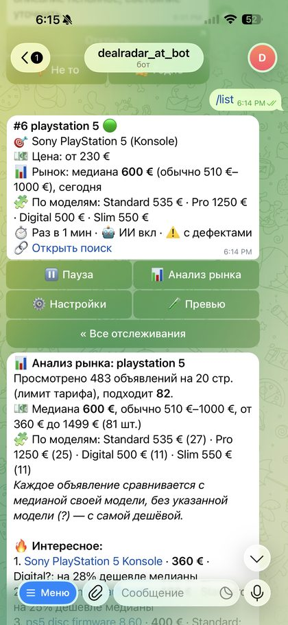
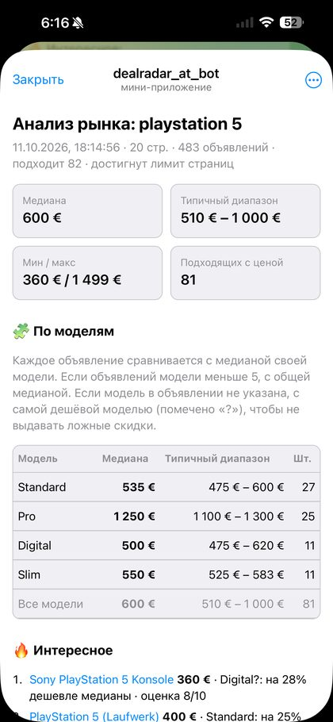
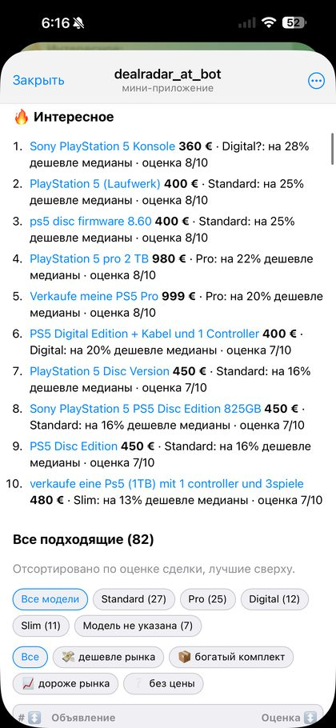

# DealRadar

[](https://github.com/IvanSytnik/dealradar/actions/workflows/ci.yml)


A Telegram bot that watches **willhaben.at** 🇦🇹 and **kleinanzeigen.de** 🇩🇪 searches and sends only the listings worth opening, with a deal score based on what that exact model really sells for.

Paste a search link (or just type `ps5 digital`). The bot works out what you are looking for, builds a filter, and notifies you about new and cheaper listings without accessories, wanted ads or junk. `/scan` reads every page of the search and shows the real market, model by model.

**Try it:** [@dealradar_austria_bot](https://t.me/dealradar_austria_bot)

<p>
  
  
  
</p>

## Why it is not just another scraper

- **Per-model market prices.** One median over "PS5" mixes a 500 € Digital with a 1250 € Pro, so every Pro looks overpriced and every standard console looks like a deal. The AI picks the item's price-relevant variants once per watch, tags each listing with one, and each variant with at least 5 priced listings gets its own median. A listing that does not name its model is compared with the cheapest variant (sellers always name the expensive one), so it never shows a fake discount. Live Stuttgart PS5 search, 483 listings: Standard 535 €, Digital 500 €, Slim 550 €, Pro 1250 €; overall 600 €.
- **Real numbers, not a model's guess.** Deal scores come from the median and quartiles of the live market. The AI judges relevance, condition, bundle and scam signals, never the price.
- **Rules first, AI second.** A German marketplace lexicon and per-watch rules drop most junk for free; only what passes costs an AI call, in batches of 20 with a cache and a daily budget per user.
- **Polite by design.** One request per unique URL per cycle however many users watch it, a per-host queue, backoff with jitter, and a per-site floor (Kleinanzeigen: 10 min default, never under 5).

## Features

**Watching**
- **Two marketplaces:** Willhaben (any search URL: keyword, category, region, price) and Kleinanzeigen (`/s-<category>/<keyword>/k0c<id>`, `seite:N` pagination, parser built from the live Tailwind markup and the cards' JSON-LD). Plain text searches Willhaben across Austria. URLs are canonicalised to newest first, tracking params stripped.
- **Auto filter profile.** The AI reads the query and returns match groups (`series s | xbox s | xss`), exclusions (other models, cases, games), accessory words (fine in a bundle, not alone), a sane price floor and the item's variants. All plain words, never regexes, validated with zod; a deterministic fallback runs without AI.
- **Three filter layers:** marketplace-wide lexicon (wanted ads, swaps, empty boxes, repair services, defects), per-watch rules, then the AI verdict (relevant, condition, bundle, model, score 1–10).
- **Instant preview** on creation: how many current listings pass and why the others were dropped. Everything already online is memorised, so only genuinely new listings are sent, plus price drops with the old price struck through.
- **Learns from feedback:** 👎/👍 under each notification become few-shot examples for that watch.

**Market analysis (`/scan`)**
- Reads every page (5 on Free, 20 on Pro), filters, screens the rest with the AI, computes overall and per-model medians, scores each listing against its own model. Highlights deals, lists cheap broken units separately for repair or resale, flags suspiciously cheap ones.
- The full report opens as a **Telegram Mini App** (Telegram theme from the launch hash, listings open via `web_app_open_link`), with a per-model table, model and deal-tag filters and sorting; a browser link (S3 + CloudFront, 30 days) and the HTML file as fallbacks.
- The medians are stored on the watch: live notifications say "20 % below the Pro median".

**Product**
- **Four languages** (de, en, uk, ru), picked from the Telegram app language or `/lang`. The AI writes its descriptions and notes in the same language. Locales are type-checked against the reference; tests check that every string's Telegram HTML is balanced and button labels fit.
- **Onboarding in one tap:** `/start` explains the bot and offers example searches that create a watch immediately; `/help` is split into topics, including how to copy a search link.
- **Plans** (Free / Pro): watches, minimum interval, AI calls and scans per day. **Invites:** `/invite` gives a personal link; a new user and the inviter each get 7 days of Pro.
- **Privacy and erasure:** `/privacy` says what is stored, where (AWS Stockholm) and what goes to the AI; `/delete_me` erases the user and everything keyed by them in one transaction (GDPR Art. 17).
- **Parser health alert:** fetch outcomes feed a rolling window per site; when most recent fetches across several searches are empty or failing (layout change, IP block), the owner gets one Telegram alert, at most every 6 hours, and a "recovered" message.
- **Analytics** (`/stats`): signups, active users, notifications, AI calls, negative feedback, referrals.

## Architecture

```
src/
  sites/        SiteAdapter interface, willhaben + kleinanzeigen adapters, polite per-host HTTP queue
  core/         normalisation, marketplace lexicon, rule filter, market stats, variants, plans
  ai/           LLM port, profile builder, per-listing and batch classifiers (cache + daily budget)
  db/           SQLite migrations (user_version) + repository
  services/     WatchService, ScanService, Poller (scheduler), HealthMonitor, Notifier port
  report/       HTML report / Mini App, S3 publisher
  bot/          grammY handlers, pure command parsers, message formatting
  i18n/         de / en / uk / ru dictionaries (ru is the reference type)
tests/          vitest: unit, service, scheduler with fake clock, bot end-to-end, real-page fixtures
infra/          Terraform: EC2, ECR, SSM, S3 + CloudFront, IAM, budgets
```

The core does not depend on Telegram or Anthropic. Both sit behind ports (`Notifier`, `Llm`), so the scheduler and the bot are tested end-to-end without network access. 262 tests, `tsc --strict`, CI on every push.

**Adding a marketplace:** implement `SiteAdapter` (`matches`, `parseSearchUrl`, `searchUrlFromText`, `pageUrl`, `parseListings`, optional `minIntervalSec`), register it in `sites/index.ts`, add a fixture test from a real page, and check it with the probe below. The lexicon is German; a non-German site needs its own.

## Run locally

```bash
npm install
cp .env.example .env      # only once! it overwrites .env
npm run check             # typecheck + tests
npm start
```

Check an adapter against the live site:
```bash
npm run probe -- "https://www.kleinanzeigen.de/s-konsolen/ps5/k0c279" 2
```
Prints the canonical URL, listings per page, the first parsed listings and how many miss a price, place, image or text. Exit code 1 when nothing parsed.

## Deploy

Telegram long polling: no public URL or open port, only an always-on process and a small persistent disk for SQLite. **Run exactly one instance**, otherwise Telegram answers `409 Conflict`.

**AWS (production):** Terraform provisions EC2 Graviton (t4g.micro) with Docker, ECR, SSM Parameter Store for secrets, CloudWatch Logs, an S3 + CloudFront bucket for reports and budget alerts; no inbound ports. GitHub Actions builds the arm64 image and deploys through SSM Run Command (OIDC, or a scoped IAM user where an SCP blocks OIDC). Architecture, decisions, cost (~$12/month) and setup: [docs/aws.md](docs/aws.md).

**Any VPS or a home server:**
```bash
git clone https://github.com/IvanSytnik/dealradar && cd dealradar
cp .env.example .env && nano .env
docker compose up -d --build
```
Railway works too (`railway.json`; mount a volume at `/app/data` and set `RAILWAY_RUN_UID=0`).

Marketplaces may rate-limit data-center IPs. The bot backs off automatically, alerts the user after 5 failures and the owner when a whole site fails; a residential IP is the fallback.

## Bot commands

| | |
|---|---|
| link or text | new watch |
| `/list` | watches, with buttons: pause, market analysis, settings, preview |
| `/scan 3` | market analysis of all pages |
| `/price 3 80 220` | price range (`-` = no bound) |
| `/exclude 3 hülle, spiel` / `/unexclude 3 controller` | stop words |
| `/match 3 series s \| xbox s` | what the title must contain |
| `/score 3 6` | AI score threshold |
| `/rename 3 Name` | |
| `/plan` · `/invite` · `/lang` | plan and usage · invite link · language |
| `/privacy` · `/delete_me` | what is stored · erase everything |
| `/stats` · `/grant <id> pro` | admin |

Deep link `t.me/<bot>?start=<base64url keyword>` creates a watch straight from a landing page.

## Known limitations

- **Parsers follow the sites' current markup:** Willhaben's `__NEXT_DATA__` (`searchResult.advertSummaryList`) and Kleinanzeigen's `article[data-adid]` cards, both verified live in October 2026 with real-page fixtures. A change breaks one file and triggers the health alert.
- Exclusions match word prefixes (`huelle` hits `Hüllen`), not compound suffixes (`Schutzhülle`). The AI layer covers that; a German decompounder would be better.
- Variant medians need enough listings: a model with fewer than 5 priced listings falls back to the overall median.
- Scraping is subject to the marketplaces' terms. Request rates stay low and the data is not resold.

## Roadmap

1. **Payments:** Telegram Stars (`XTR`) for Pro, monthly subscription.
2. **Price history:** listing history per query for "15 % below the 30-day median" and price trends per model.
3. **More sites:** eBay, Vinted; one watch across several sites.
4. **Finds as tags:** low firmware, warranty, sealed box, already noticed by the AI, surfaced as filters.
5. **Scale:** Postgres and separate poller workers past ~2k active watches; webhooks instead of long polling.
6. **Observability:** Sentry, uptime ping, CloudWatch alarm on the error log pattern.
