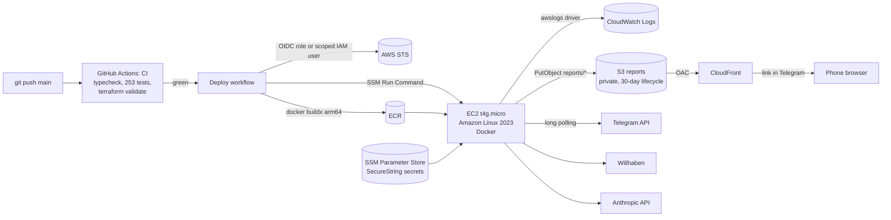

# Deploying DealRadar on AWS

Infrastructure as code in [`infra/terraform`](../infra/terraform), continuous deployment in
[`.github/workflows/deploy.yml`](../.github/workflows/deploy.yml).



## Design decisions

| Decision | Why |
|---|---|
| EC2 + Docker instead of ECS/Fargate | One long-polling process with a SQLite file. Fargate would need EFS for SQLite and costs more; a single instance is the honest minimum. |
| Graviton `t4g.micro` | Cheapest instance that fits (1 GiB RAM, bot uses ~150 MB). Image built for `linux/arm64` with buildx. |
| No inbound ports, no SSH | Security group is egress-only. Shell access and deploys go through SSM Session Manager / Run Command. |
| GitHub OIDC role, IAM user fallback | Preferred: short-lived credentials scoped to `repo:IvanSytnik/dealradar:ref:refs/heads/main`, no AWS keys in GitHub. AWS Free plan (new experience) accounts sit in an AWS-managed organization whose SCP denies `iam:*Provider*`, so `github_deploy_auth = "iam_user"` switches to a dedicated user with the same least-privilege policy; its key goes straight from the CLI into GitHub secrets, never into Terraform state. |
| Region `eu-north-1` | The same SCP allows only the account's home region plus `us-east-1`/`us-west-2`. Stockholm has Graviton and is ~25 ms from Austria. |
| Secrets in SSM Parameter Store | `SecureString`, read at container start into a root-only env file. Not in the image, not in git, not in Terraform state. |
| IMDSv2 only, encrypted EBS | Defaults that should not be optional. Hop limit 2 so the container can use the instance role. |
| Reports on S3 + CloudFront | Telegram's iOS document preview runs no JavaScript, so a report sent as a file loses sorting and filters on a phone. Reports go to a private bucket under a random 128-bit key and open through CloudFront (origin access control, no public bucket, `no-referrer`, `noindex`). A lifecycle rule deletes them after 30 days. The file is still sent as a copy. |
| Root volume survives instance replacement | `delete_on_termination = false`: the SQLite database is not lost if Terraform replaces the instance. |
| Budget with e-mail alerts | Credits run out quietly otherwise. |

## Cost (eu-north-1, on-demand)

| Item | ≈ USD / month |
|---|---|
| EC2 t4g.micro (~$0.009/h) | ~6.5 |
| Public IPv4 ($0.005/h) | 3.65 |
| EBS gp3 10 GB | ~1 |
| ECR, CloudWatch Logs, SSM, S3 + CloudFront reports | < 0.5 |
| **Total** | **≈ 12** |

A NAT gateway would avoid the public IP but costs ~$35/month, so the instance gets a public IPv4 with no inbound rules.

## Setup

Prerequisites: AWS account, `aws` CLI, Terraform ≥ 1.6, `gh` CLI.

```bash
# 1. Infrastructure
cd infra/terraform
cp terraform.tfvars.example terraform.tfvars   # set alert_email (and github_deploy_auth on Free plan accounts)
terraform init
terraform apply

# 2. Secrets (typed, not stored in shell history)
for name in TELEGRAM_BOT_TOKEN ANTHROPIC_API_KEY ADMIN_IDS; do
  read -rs -p "$name: " value; echo
  aws ssm put-parameter --name "/dealradar/$name" --type SecureString --value "$value" --overwrite
done
aws ssm put-parameter --name /dealradar/AI_MODEL --type String --value claude-haiku-5-5 --overwrite

# 3. GitHub variables for the deploy workflow
gh variable set AWS_REGION      --body "$(terraform output -raw region)"
gh variable set ECR_REPOSITORY  --body "$(terraform output -raw ecr_repository)"
gh variable set EC2_INSTANCE_ID --body "$(terraform output -raw instance_id)"

# 3a. OIDC mode
gh variable set AWS_DEPLOY_ROLE_ARN --body "$(terraform output -raw github_deploy_role_arn)"

# 3b. IAM user mode: the key goes from AWS straight into GitHub secrets
read -r key secret <<< "$(aws iam create-access-key --user-name "$(terraform output -raw github_deploy_user)" \
  --query 'AccessKey.[AccessKeyId,SecretAccessKey]' --output text)"
gh secret set AWS_ACCESS_KEY_ID --body "$key"
gh secret set AWS_SECRET_ACCESS_KEY --body "$secret"
unset key secret

# 4. Stop any other running copy of the bot, then deploy
gh workflow run Deploy
gh run watch
```

## Operations

```bash
aws logs tail /dealradar/bot --follow                                  # logs
aws ssm start-session --target "$(terraform output -raw instance_id)"   # shell (needs session-manager-plugin)
gh workflow run Deploy                                                  # redeploy current main
```

Rollback: re-run the Deploy workflow for an older commit, or on the instance `sudo /opt/dealradar/run.sh <commit-sha>`.

Teardown: `terraform destroy`. The root volume is kept on purpose (it holds the database); delete it in the EC2 console when it is no longer needed.

## Next steps

- Remote Terraform state in S3 with locking (state is local for now).
- Move back to OIDC once the account allows creating the GitHub identity provider; rotate the deploy key until then.
- Nightly SQLite backup to S3 (`sqlite3 .backup` + `aws s3 cp`).
- CloudWatch alarm on the error log pattern and on instance status checks.
